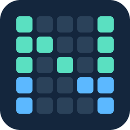

# NovaStar COEX for Home Assistant



Control a **NovaStar MX40 Pro LED video wall** from Home Assistant over your local
network. Set brightness, select an input, switch processing modes, freeze or black
out the picture, and monitor controller temperature. No cloud account is needed.

This is an independent community integration, not an official NovaStar product.
The integration domain is `novastar_coex`; it includes an async Python client and CLI.

## Compatibility

| Requirement | Support |
| --- | --- |
| Home Assistant | **2026.3.1 or newer**; automated tests cover 2026.3.1 and 2026.10.4 |
| Controller | **MX40 Pro**, hardware-tested with V1.5.0 firmware |
| Other COEX controllers | May share the API, but MX20, MX30, CX-series and KU-series are **unverified** |
| Connection | Local HTTP, TCP port **8001** by default |
| Standalone Python client | Python **3.12+**; Home Assistant uses its own Python version |

Configure the wall and its screens in NovaStar VMP first. Give the controller a
stable address, make sure Home Assistant can reach it, and close VMP before adding
it. VMP can hold an exclusive lock that blocks API access.

## Install

### HACS custom repository

Install this integration as a HACS custom repository. Default-store inclusion is
a separate review process; it is not required for this installation.

1. Open **HACS → ⋮ → Custom repositories**.
2. Add `https://github.com/mikolalysenko/novastar-coex` with type **Integration**.
3. Find **NovaStar COEX** in HACS and download it.
4. Restart Home Assistant.
5. Open **Settings → Devices & services → Add integration → NovaStar COEX**.
6. Enter the controller's IP address or hostname, port (normally `8001`), and a
   device name (default: **Video Wall**). Enter the host without `http://` or a path.

[Open this repository in HACS](https://my.home-assistant.io/redirect/hacs_repository/?owner=mikolalysenko&repository=novastar-coex&category=integration)

### Manual installation

Download a release from the [releases page](https://github.com/mikolalysenko/novastar-coex/releases).
Extract the release's `novastar_coex-v<version>.zip` into your Home Assistant
configuration directory, or copy `custom_components/novastar_coex/` from the source
archive there. The result must be `<config>/custom_components/novastar_coex/manifest.json`.
Restart Home Assistant, then add the integration as above. No YAML configuration is required.

## Entities and behavior

With a single screen and the default device name, Home Assistant normally assigns
these IDs. Existing entity names or collisions can change them; use your actual
entity IDs in automations. Each screen receives its own controls. With multiple
screens, their screen names distinguish the entities. The sensors belong to the controller.

| Entity | Example entity ID | Behavior |
| --- | --- | --- |
| Display | `switch.video_wall_display` | On: normal output. Off: blackout. Frozen output still counts as on. |
| Freeze | `switch.video_wall_freeze` | On: hold the current frame. Off: normal output, including leaving blackout. |
| Brightness | `number.video_wall_brightness` | 0–100%; requires powered, connected cabinets on the tested MX40 Pro |
| Input | `select.video_wall_input` | Route a reported input to the main layer of the current processing mode |
| Working mode | `select.video_wall_working_mode` | `Send-Only` or `All-in-One` |
| Preset | `select.video_wall_preset` | Apply an existing VMP preset; labels include the slot number |
| Color temperature | `number.video_wall_color_temperature` | 1700–15000 K; configuration control |
| Gamma | `number.video_wall_gamma` | 1.0–4.0; configuration control |
| Cabinet mapping | `switch.video_wall_cabinet_mapping` | Show cabinet numbers for servicing; affects **all reported cabinets**, even with multiple screens |
| Temperature | `sensor.video_wall_temperature` | Highest reported controller temperature, °C |
| Runtime | `sensor.video_wall_runtime` | Reported runtime, seconds |
| Cabinets | `sensor.video_wall_cabinets` | Number of cabinets in the monitoring response, when supplied |

**Display off means blackout, not power off or standby.** The controller remains
powered, and the integration does not control cabinet power relays. Display and
Freeze both change the same display mode: operating either switch can replace the
other's mode. Reboot, soft standby, EDID editing and calibration are not exposed
as Home Assistant controls.

**Send-Only** requires the source timing to match the wall; **All-in-One** uses the
controller's scaler. Changing modes can interrupt the picture and changes which
layer is used for input selection. Input names come from the controller, for
example `HDMI2.0 1` or `DP1.2`; the integration does not rename them.

State is polled every 10 seconds. Monitoring is normally read every sixth poll
(about one minute), with retries after missing data. Successful writes request a
refresh. Missing optional data appears as unknown or an empty selection; losing
the controller or encountering a VMP lock makes its entities unavailable.

## Automation example

Use Home Assistant's standard number, select and switch actions. Replace the IDs
and input option with the values shown in your installation.

```yaml
alias: Video wall movie settings
sequence:
  - action: select.select_option
    target:
      entity_id: select.video_wall_working_mode
    data:
      option: All-in-One
  - delay: "00:00:03"
  - action: select.select_option
    target:
      entity_id: select.video_wall_input
    data:
      option: "HDMI2.0 1"
  - action: number.set_value
    target:
      entity_id: number.video_wall_brightness
    data:
      value: 30
  - action: switch.turn_on
    target:
      entity_id: switch.video_wall_display
```

To black out the wall, call `switch.turn_off` on `switch.video_wall_display`.
Power and AVR sequencing depend on your installation and must be handled separately.

## Known limits and troubleshooting

- **Device locked / unavailable:** close VMP on every computer, then wait for the
  next poll. Also check controller power, its address, and TCP port 8001 reachability.
- **No configured screens:** create a screen in VMP before adding the integration.
- **Brightness unknown or writes have no visible effect:** check cabinet power.
  The tested controller returns empty display parameters when cabinets are off and
  can acknowledge brightness writes without applying them.
- **Empty presets:** save presets in VMP first. Preset application, color-temperature
  and gamma writes are covered by simulated tests but still need physical verification.
- **New screens missing:** reload the integration after changing the screen layout.
  Screens are discovered during setup. Removed screens become unavailable.
- **Address changed:** restore the reserved address, or remove and re-add the
  integration at its new address. Entity customizations may need to be reapplied.
- **Black picture despite normal status:** API state cannot prove that a source is
  rendering frames. Check the selected input, source timing, working mode and video cabling.

The API is unencrypted and has no authentication. Keep it on a trusted local
network and do not expose port 8001 to the internet.

For a bug report, include integration/Home Assistant versions, controller model
and firmware, the action taken, and sanitized logs. Enable debug logging from the
integration's menu, reproduce the issue, then disable it. Inspect logs before
sharing: they can contain local addresses and screen IDs. See
[CONTRIBUTING.md](CONTRIBUTING.md) and the [hardware verification notes](docs/HARDWARE-VERIFICATION.md).

## Updates and removal

Update through HACS, or replace the component directory with a newer release, then
restart Home Assistant. To roll back, download the earlier release and restart.
Before uninstalling, remove the NovaStar COEX entry under Devices & services;
then remove its files through HACS or delete the component directory and restart.

## Python client and development

```bash
git clone https://github.com/mikolalysenko/novastar-coex.git
cd novastar-coex
make sync
uv run coex --host 192.0.2.10 status
uv run coex --host 192.0.2.10 brightness 30
```

`192.0.2.10` is an example address; substitute your controller's address.
The CLI and Python package can be installed from source or a release wheel; a PyPI
publication is not required for Home Assistant or HACS.

```python
from novastar_coex import CoexClient


async def dim_wall():
    async with CoexClient("192.0.2.10") as controller:
        await controller.get_status()  # Learn the brightness unit from the controller.
        await controller.set_brightness(30)
```

The client is bundled inside the integration so HACS installs all runtime code.
See [API notes](docs/API.md), [development](docs/DEVELOPMENT.md),
[release procedure](docs/RELEASING.md), and [changelog](CHANGELOG.md).

Licensed under the [MIT license](LICENSE). NovaStar and its product names belong
to their respective owners. The LED-grid icon is original artwork for this project.
